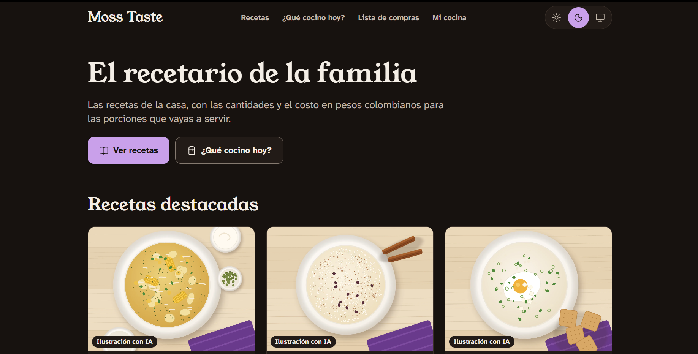
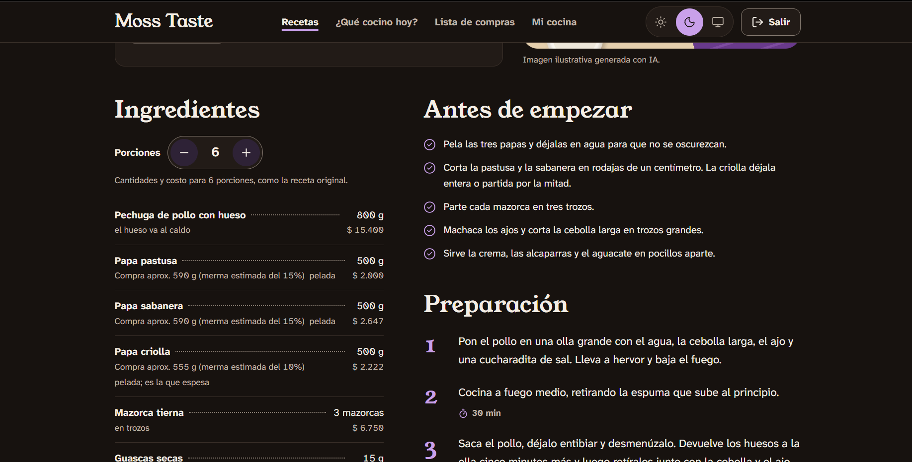
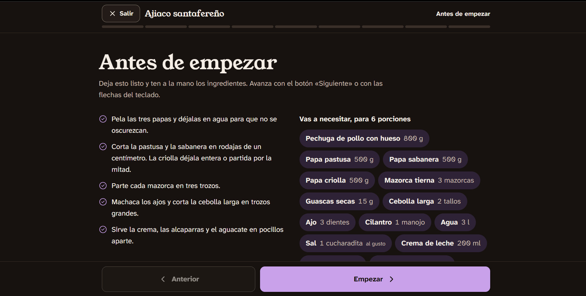
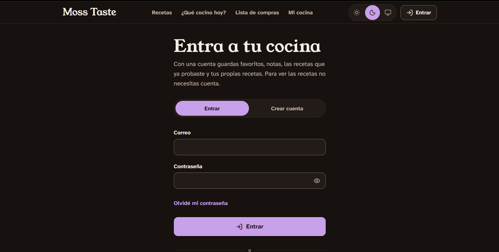

# Moss Taste

El recetario de la familia: las recetas de la casa, con las cantidades y el costo en pesos colombianos para las porciones que vayas a servir, y un modo cocina pensado para las manos ocupadas.

**Sitio:** https://sergio-velandia.dev/Moss-Taste/

## Por qué existe

Las recetas de mi familia vivían en papel y en hojas de cálculo. Cocinar para más o menos gente obligaba a recalcular las porciones en Excel, cuya interfaz a veces resulta algo agresiva para quien solo quiere cocinar.

Moss Taste digitaliza esas recetas para que mis familiares que estudiaron gastronomía eviten el papeleo excesivo y tengan las porciones y los costos en un solo lugar.

## Vista previa

| Inicio | Una receta |
|---|---|
|  |  |

| Modo cocina | Cuenta |
|---|---|
|  |  |

Las ilustraciones de los platos son generadas con IA y se etiquetan así en el sitio. El tema por defecto es el claro; estas capturas están en el oscuro.

## Qué se puede hacer

**Sin cuenta:**

- **Calcular cualquier receta:** eliges las porciones y se recalculan las cantidades y el costo.
- **Cocinar en el modo cocina:** un paso a la vez, con letra grande y temporizadores que suenan.
- **Buscar y filtrar** por nombre, ingrediente, categoría y presupuesto.
- **Preguntar «¿Qué cocino hoy?»:** según lo que tienes o lo que quieres gastar.
- **Armar la lista de compras:** junta varias recetas y separa lo que cuestan de lo que se paga hoy en caja.
- **Exportar** una receta o la lista a Excel, CSV o JSON.
- **Proponer una receta** desde el [formulario de contacto](https://sergio-velandia.dev/Moss-Taste/contacto/).

**Con cuenta** (correo o Google):

- Guardar favoritas, notas y las recetas que ya probaste.
- Crear recetas personales, que otras cuentas no ven, con el mismo cálculo y el mismo modo cocina.
- Llevar la lista de compras a la cuenta.
- Exportar tus datos o borrar tu cuenta.

**Los costos son estimados de referencia**, no el valor exacto de tu tienda. En [Acerca](https://sergio-velandia.dev/Moss-Taste/acerca/) se explica cómo se calculan, cómo filtra el presupuesto y qué esperar de los temporizadores.

## Desarrollo

Usa la versión de Node de [.nvmrc](.nvmrc).

```bash
npm install
npm run dev         # http://localhost:5173/Moss-Taste/
npm test            # datos, contraste de colores, cálculo y pantallas
npm run test:reglas # reglas de Firestore contra el emulador (necesita Java 21)
npm run lint        # oxlint
npm run build       # typecheck + build + un index.html por ruta fija y por receta
npm run preview     # sirve el build en http://localhost:4173/Moss-Taste/
npm run imagenes    # genera imagen.webp y miniatura.webp de las recetas
```

Cada push a `main` corre pruebas, reglas, lint y build, y publica en GitHub Pages ([workflow](.github/workflows/desplegar.yml)).

### Cuentas con Firebase

Authentication y Firestore, en plan gratuito (Spark). Sin configuración el sitio funciona, pero sin cuentas.

La configuración de Firebase no es un secreto: ver [SECURITY.md](SECURITY.md).

**Para desarrollar:** copia `.env.example` como `.env` y llena los cuatro valores.

**Para publicar:** GitHub Actions compila en sus servidores, donde `.env` no existe. En **Settings → Secrets and variables → Actions → pestaña Variables** (no Secrets: GitHub enmascara los secretos y puede romper el build) deben estar:

`VITE_FIREBASE_API_KEY`, `VITE_FIREBASE_AUTH_DOMAIN`, `VITE_FIREBASE_PROJECT_ID`, `VITE_FIREBASE_APP_ID`

**Las reglas:** `firestore.rules` es la única fuente de verdad. No se despliegan solas: se pegan en la consola (Firestore → Reglas), y cada vez se anota la fecha en el [CHANGELOG](CHANGELOG.md). Si la consola y el repo no coinciden, gana el repo.

**Probar las reglas:** `npm run test:reglas` usa el emulador, con un proyecto `demo-` que nunca toca el Firebase real. Necesita Java 21. `firebase-tools` no está en `package.json`: lo trae `npx` con versión fija. Si tienes otra versión de Java, no hace falta cambiarla: descomprime un JDK 21 (por ejemplo, Temurin) en cualquier carpeta y, en Git Bash, antes de correr el comando:

```bash
export JAVA_HOME="/ruta/al/jdk-21"
export PATH="$JAVA_HOME/bin:$PATH"
npm run test:reglas
```

## Más documentación

- [CHANGELOG.md](CHANGELOG.md): qué cambió en cada versión.
- [ROADMAP.md](ROADMAP.md): lo que falta y lo que puede venir.
- [CONTRIBUTING.md](CONTRIBUTING.md): cómo reportar un problema, agregar una receta y las convenciones del repo.
- [SECURITY.md](SECURITY.md): cómo reportar un fallo de seguridad. **Léelo antes de correr `npm audit fix`.**
- [CLAUDE.md](CLAUDE.md): decisiones, stack y mapa del código.
- [Política de privacidad](https://sergio-velandia.dev/Moss-Taste/privacidad/): qué se guarda, dónde y cómo ejercer tus derechos.

## Licencia

Código bajo [MIT](LICENSE) y textos de las recetas bajo [CC BY 4.0](LICENSE-CONTENT). El detalle, con las imágenes y las fuentes, está en la [página de licencia](https://sergio-velandia.dev/Moss-Taste/licencia/).
